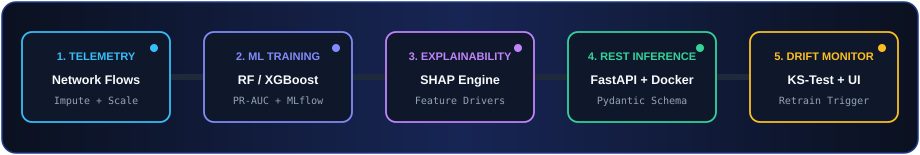
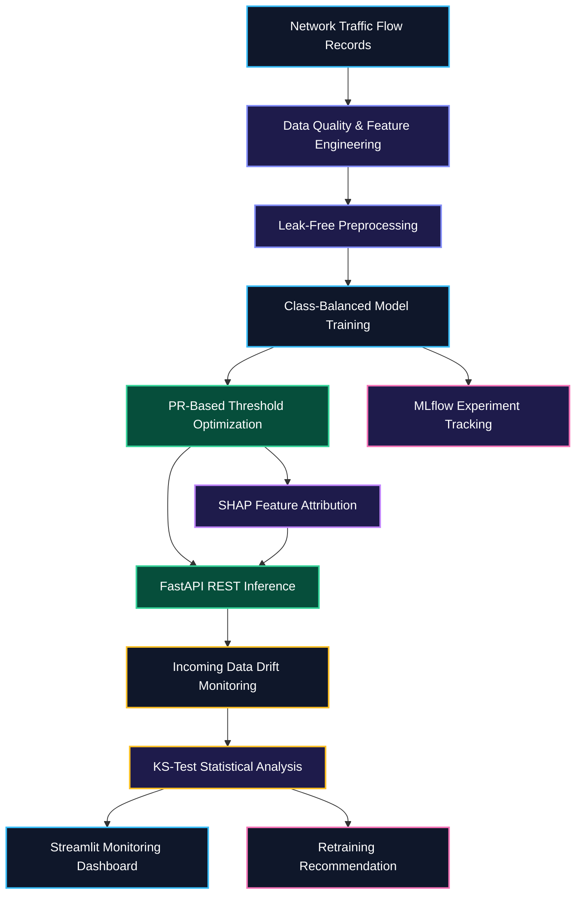

# 🛡️ SentinelML — Explainable Network Intrusion Detection & MLOps Pipeline

<div align="center">
  

  <br/><br/>

  
  
  
  
  
  
</div>

---

## 📌 Overview

**SentinelML** is an end-to-end machine learning and MLOps platform designed to detect potentially malicious network traffic under severe class imbalance.

Rather than relying solely on accuracy, SentinelML combines leak-free preprocessing, class-balanced model training, precision-recall threshold optimization, local **SHAP explainability**, validated **FastAPI** inference, **MLflow** experiment tracking, and statistical data-drift monitoring.

The project demonstrates how machine learning can be integrated into a reproducible, testable, and observable cybersecurity workflow.

### 🎯 Project Objectives

- Detect potentially malicious network traffic using machine learning.
- Compare classification models using appropriate evaluation metrics.
- Reduce data leakage through training-only preprocessing.
- Optimize decision thresholds using precision-recall analysis.
- Explain individual predictions using SHAP feature attributions.
- Expose predictions through validated REST endpoints.
- Monitor changes in incoming network telemetry.
- Track experiments, parameters, metrics, and artifacts using MLflow.
- Validate API behavior with automated tests and CI.
- Support containerized execution using Docker.

---

## 🏗️ End-to-End Pipeline & Architecture

<div align="center">
  
</div>

### System Architecture



The pipeline separates data preparation, model development, inference, explainability, and monitoring to make the workflow easier to test and maintain.

---

## 📊 Model Benchmark & Experimental Results

The following benchmark values are the reported results supplied for this project. They should be reproducible from the training pipeline and its saved evaluation artifacts.

| Candidate Model | PR-AUC | F1-Score | Recall | Optimal Threshold |
|---|---:|---:|---:|---:|
| 🏆 Random Forest Classifier | 0.8891 | 0.9200 | 0.8625 | 0.5533 |
| XGBoost Classifier | 0.8852 | 0.9200 | 0.8625 | 0.5410 |
| Logistic Regression | 0.8808 | 0.9128 | 0.8500 | 0.5120 |

**Reported best candidate:** Random Forest Classifier.

The Random Forest model has the highest reported PR-AUC in this comparison. The F1-score and recall are also important because an intrusion detection system must balance missed attacks against false alarms.

### Evaluation Considerations

- Fit imputers, scalers, and other preprocessing transformations using training data only.
- Use held-out evaluation data for model comparison.
- Select the decision threshold using validation data rather than the final test set.
- Document the positive class, split strategy, and averaging method for each metric.
- Re-run the benchmark to verify that the displayed values match the saved artifacts.

*Note: The reported F1-score, recall, and threshold values are retained from the supplied project information. Their exact calculation methods and reproducibility should be confirmed from the training code before treating them as independently validated results.*

---

## 🔧 Core ML & MLOps Capabilities

### 1. Imbalanced Classification & Threshold Calibration

Intrusion datasets may contain far fewer malicious samples than normal traffic. Accuracy alone can therefore hide poor detection performance.

SentinelML compares Logistic Regression, Random Forest, and XGBoost models and supports class-imbalance handling and decision-threshold tuning.

The objective is to identify a useful balance between precision and recall for the target classification task.

### 2. Leak-Free Preprocessing

The preprocessing pipeline is designed to handle missing values and feature scaling consistently.

- `SimpleImputer` handles missing values.
- `StandardScaler` scales numerical features where appropriate.
- Training-only fitting helps prevent information leakage into evaluation data.
- A reusable pipeline helps maintain consistency between training and inference.

### 3. Explainable AI with SHAP

SHAP feature attributions help inspect the factors contributing to a model's prediction.

The reported telemetry features include:

- `dst_port_entropy`
- `failed_login_attempts`
- `flow_bytes_per_sec`
- `syn_flag_count`

These explanations can help developers investigate model behavior and understand which input features influenced a particular prediction.

SHAP explanations describe model behavior; they do not independently establish that a network flow is malicious.

### 4. Statistical Data Drift Monitoring

SentinelML uses two-sample Kolmogorov-Smirnov testing to compare reference and incoming numerical feature distributions.

The reported monitoring configuration evaluates nine telemetry features.

The drift engine can flag distribution changes for investigation. A drift alert is not proof of reduced model accuracy, and it should not automatically trigger a production retraining operation without additional safeguards.

A PSI-based monitoring extension can be included if it is implemented in the current codebase.

### 5. FastAPI Inference & Validation

FastAPI exposes model inference through REST endpoints, with Pydantic schemas for request validation.

The documented API surface includes:

- `/health` — service health check, if implemented.
- `/metrics` — model or service metrics, if implemented.
- `/predict` — prediction endpoint.
- `/drift-status` — drift status endpoint.

Interactive API documentation is available through Swagger UI when the server is running.

### 6. MLflow Experiment Tracking

MLflow supports experiment tracking for model development.

Depending on the implementation, recorded information can include:

- Model parameters and configuration.
- PR-AUC, F1-score, recall, and other evaluation metrics.
- Experiment run identifiers.
- Model artifacts and serialized pipelines.

### 7. Streamlit Monitoring Dashboard

The Streamlit dashboard provides an interactive interface for inspecting model predictions, feature explanations, and data drift.

Its exact features depend on the implemented dashboard pages and the availability of the relevant model and monitoring artifacts.

### 8. Automated Testing & CI/CD

Pytest validates API behavior and expected inference responses. GitHub Actions can run these tests automatically when changes are pushed or pull requests are opened.

Docker provides a consistent runtime environment for the inference service.

---

## 🧰 Technology Stack

| Component | Technology | Purpose |
|---|---|---|
| Language | Python 3.11 | Core application and ML code |
| Data Processing | Pandas, NumPy | Feature engineering and data handling |
| Machine Learning | Scikit-learn | Preprocessing, baselines, evaluation |
| Gradient Boosting | XGBoost | Classification model |
| Explainability | SHAP | Feature attribution |
| API | FastAPI | REST inference endpoints |
| Validation | Pydantic | Request and response schemas |
| Experiment Tracking | MLflow | Experiment metrics and artifacts |
| Drift Detection | SciPy | Statistical tests such as `ks_2samp` |
| Dashboard | Streamlit | Interactive monitoring UI |
| Testing | Pytest | Automated API and pipeline tests |
| Containerization | Docker | Reproducible runtime |
| CI/CD | GitHub Actions | Automated validation workflow |

---

## 📂 Repository Structure

```text
SentinelML/
├── .github/
│   └── workflows/
│       └── ci.yml                 # GitHub Actions CI workflow
├── api/
│   └── main.py                    # FastAPI inference and monitoring endpoints
├── app/
│   └── dashboard.py               # Streamlit XAI and drift dashboard
├── assets/
│   ├── sentinel-banner.svg        # Animated repository banner
│   └── sentinel-pipeline.svg      # Pipeline illustration
├── data/
│   └── raw/                       # Generated or source telemetry data
├── models/                        # Saved pipelines and model metadata
├── src/
│   ├── data/
│   │   └── generate_data.py       # Synthetic telemetry generation
│   ├── models/
│   │   └── train.py               # Model training and MLflow tracking
│   └── monitoring/
│       └── drift.py               # KS-test drift monitoring
├── tests/
│   └── test_api.py                # API and inference tests
├── Dockerfile                     # Container build instructions
├── requirements.txt               # Python dependencies
├── .gitignore
└── README.md
```

*This structure describes the expected layout. Adjust it to match the files actually present in the repository.*

---

## 🚀 Quickstart & Local Execution

### Prerequisites

- Git
- Python 3.11
- pip
- Docker (optional)

### 1. Clone the Repository

```powershell
git clone https://github.com/Aditya70-creator/SentinelML.git
cd SentinelML
```

### 2. Create and Activate a Virtual Environment

**Windows PowerShell**

```powershell
python -m venv .venv
.\.venv\Scripts\Activate.ps1
```

If script execution is blocked by your PowerShell policy, you can use the virtual environment's Python executable directly:

```powershell
.\.venv\Scripts\python.exe -m pip install --upgrade pip
.\.venv\Scripts\python.exe -m pip install -r requirements.txt
```

**Linux / macOS**

```bash
python3 -m venv .venv
source .venv/bin/activate
python -m pip install --upgrade pip
pip install -r requirements.txt
```

### 3. Install Dependencies

If you activated the environment in PowerShell:

```powershell
python -m pip install --upgrade pip
pip install -r requirements.txt
```

### 4. Generate Network Telemetry

```powershell
python -m src.data.generate_data
```

This command should generate the dataset files expected by the training pipeline.

### 5. Train and Evaluate Models

```powershell
python -m src.models.train
```

The training script should preprocess the data, train the configured candidate models, evaluate performance, and log experiments to MLflow where configured.

### 6. Run the Test Suite

```powershell
pytest -v
```

Resolve failing tests before considering the current code version validated.

### 7. Start the FastAPI Server

```powershell
uvicorn api.main:app --reload --host 127.0.0.1 --port 8000
```

Open Swagger UI:

http://127.0.0.1:8000/docs

Alternative API schema endpoint:

http://127.0.0.1:8000/openapi.json

### 8. Launch the Streamlit Dashboard

Open a second terminal, activate the virtual environment, and run:

```powershell
streamlit run app/dashboard.py
```

The default local dashboard URL is:

http://localhost:8501

The API and dashboard may need to be configured to point to the same API base URL.

---

## 📡 API Usage

### Example `/predict` Request

The following payload illustrates the reported nine-feature telemetry schema. The field names and types must match the Pydantic model implemented in `api/main.py`.

```json
{
  "flow_duration_ms": 1450.5,
  "total_fwd_packets": 52,
  "total_bwd_packets": 3,
  "packet_length_mean": 820.0,
  "syn_flag_count": 7,
  "rst_flag_count": 3,
  "flow_bytes_per_sec": 74000.0,
  "failed_login_attempts": 4,
  "dst_port_entropy": 0.82
}
```

### Test the Endpoint

With the API server running, save the example payload as `sample_request.json` and execute this PowerShell command:

```powershell
Invoke-RestMethod `
  -Uri "http://127.0.0.1:8000/predict" `
  -Method Post `
  -ContentType "application/json" `
  -InFile "sample_request.json"
```

This request is an example of the intended workflow. It will work only if the running API accepts this exact payload schema and has loaded the required model artifacts.

### API Endpoints

| Endpoint | Intended Purpose |
|---|---|
| `GET /health` | Check service health |
| `GET /metrics` | Retrieve available metrics |
| `POST /predict` | Generate a prediction |
| `GET /drift-status` | Inspect the current drift status |

*Verify the actual HTTP methods, endpoint names, and response formats against the FastAPI implementation.*

---

## 🐳 Docker Deployment

Build the image from the project root:

```powershell
docker build -t sentinelml .
```

Start the inference service:

```powershell
docker run --rm -p 8000:8000 sentinelml
```

Open the API documentation:

http://localhost:8000/docs

### Docker Notes

The Dockerfile should:

- Install the project's required dependencies.
- Copy the necessary application modules.
- Include or reliably load the required model artifacts.
- Expose the configured API port.
- Start the application with the correct ASGI module and host binding.

For a containerized API, the startup command typically needs to bind to `0.0.0.0` inside the container. The local development command above binds to `127.0.0.1` for local access.

The Streamlit dashboard is not automatically available in the same container unless the Docker configuration explicitly starts it.

---

## 🔬 Engineering Practices

SentinelML is designed around practical machine learning engineering principles:

- **Leakage prevention:** Fit preprocessing transformations on training data only.
- **Reproducibility:** Keep experiment configuration, seeds, and evaluation procedures documented.
- **Model consistency:** Use the same preprocessing transformations at inference time.
- **Input validation:** Reject malformed or invalid API requests.
- **Testing:** Cover expected requests, invalid inputs, and important edge cases.
- **Observability:** Track experiment metrics and monitor changes in incoming data.
- **Artifact management:** Keep model versions and metadata organized.
- **Secure development:** Avoid committing credentials, secrets, and unnecessary large data files.
- **Automated checks:** Run tests through GitHub Actions where configured.

---

## 🗺️ Engineering Roadmap

The following milestones describe the intended project scope. Mark a milestone complete only when the corresponding implementation and tests have been verified.

- [ ] Synthetic network-flow telemetry and drifted-batch generation
- [ ] Leak-free preprocessing with `SimpleImputer` and `StandardScaler`
- [ ] Logistic Regression, Random Forest, and XGBoost comparison
- [ ] Precision-recall threshold calibration
- [ ] Reproducible benchmark results and saved model metadata
- [ ] SHAP feature attribution in the inference workflow
- [ ] KS-test-based feature drift monitoring
- [ ] Documented drift alert and retraining recommendation logic
- [ ] MLflow experiment and artifact tracking
- [ ] Interactive Streamlit explainability and monitoring dashboard
- [ ] Automated API and schema validation tests
- [ ] Dockerized inference service
- [ ] GitHub Actions workflow with passing tests
- [ ] Documented API examples and reproducible setup instructions

---

## 🔐 Security & Responsible Use

SentinelML is intended for educational, research, and defensive cybersecurity applications.

- Use authorized datasets and network telemetry.
- Protect sensitive network-flow records and operational information.
- Validate API inputs and avoid exposing internal exceptions or sensitive data.
- Treat predictions as decision-support signals rather than definitive proof of malicious activity.
- Evaluate false positives and false negatives before using a model in an operational environment.
- Do not deploy the model as a production security control without appropriate testing, monitoring, and human oversight.

---

## 🤝 Contributing

Contributions, bug reports, and improvement suggestions are welcome.

1. Fork the repository.
2. Create a feature branch.
3. Make your changes.
4. Run relevant tests.
5. Submit a pull request describing the change.

For model, API, or monitoring changes, include tests where practical.

## 📄 License

This project uses the MIT License if the repository includes a valid MIT `LICENSE` file.

See [`LICENSE`](./LICENSE) for the license terms.

## 👨‍💻 Author

**Aditya Mitra**

- GitHub: [@Aditya70-creator](https://github.com/Aditya70-creator)
- Repository: [SentinelML](https://github.com/Aditya70-creator/SentinelML)

---

<div align="center">
  <b>Building reliable, explainable, and reproducible machine learning systems.</b>
</div>
