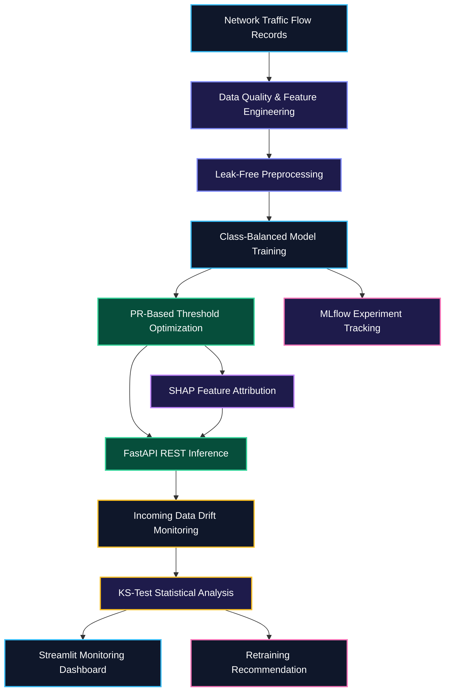

# 🛡️ SentinelML — Explainable Network Intrusion Detection & MLOps Pipeline

<div align="center">
  

  <br/><br/>

  <a href="https://sentinel-8xkyi5wo6ggso83y8jbvxz.streamlit.app/" target="_blank">
    
  </a>

  <br/><br/>

  
  
  
  
  
  
</div>

---

## 🌐 Live Interactive Deployment

Explore the deployed platform directly in your browser without installing anything locally.

**[🚀 Launch SentinelML Live Platform](https://sentinel-8xkyi5wo6ggso83y8jbvxz.streamlit.app/)**

The platform brings model evaluation, explainability, drift monitoring, and API testing together in one interactive interface.

### Live Platform Modules

1. **📊 Model Leaderboard & Metrics** — Compare PR-AUC, F1-score, precision, recall, and decision thresholds across candidate models.
2. **🔍 Interactive XAI Traffic Inspector** — Adjust nine network-flow telemetry features and inspect SHAP feature-attribution visualizations.
3. **📉 Data Drift & MLOps Monitor** — Run Kolmogorov-Smirnov (`ks_2samp`) tests to compare reference and incoming traffic batches.
4. **📡 Interactive REST API Playground** — Test `POST /predict`, `GET /health`, and `GET /drift-status` using JSON payloads validated by Pydantic.

---

## 📌 Overview

**SentinelML** is an end-to-end machine learning and MLOps platform designed to detect potentially malicious network traffic under severe class imbalance.

Rather than relying solely on accuracy, SentinelML combines leak-free preprocessing, class-imbalance handling, precision-recall threshold calibration, local **SHAP explainability**, **FastAPI** inference, **MLflow** experiment tracking, and statistical data-drift monitoring.

The project demonstrates how machine learning can be integrated into a reproducible, testable, and observable cybersecurity workflow.

### 🎯 Project Objectives

- Detect potentially malicious network traffic using machine learning.
- Compare classification models using appropriate evaluation metrics.
- Reduce data leakage through training-only preprocessing.
- Optimize decision thresholds using precision-recall analysis.
- Explain individual predictions using SHAP feature attributions.
- Expose predictions through validated REST API endpoints.
- Monitor changes in incoming network telemetry.
- Track experiments, parameters, metrics, and artifacts using MLflow.
- Validate API behavior through automated testing and CI.
- Support containerized execution using Docker.

---

## 🏗️ End-to-End Pipeline & Architecture

<div align="center">
  
</div>

### System Architecture



The pipeline separates data preparation, model development, inference, explainability, and monitoring to make the workflow easier to test, reproduce, and maintain.

---

## 📊 Model Benchmark & Experimental Results

| Candidate Model | PR-AUC | F1-Score | Precision | Recall | Optimal Threshold |
|---|---:|---:|---:|---:|---:|
| 🏆 Random Forest Classifier | 0.8891 | 0.9200 | 0.9857 | 0.8625 | 0.5533 |
| XGBoost Classifier | 0.8852 | 0.9200 | 0.9857 | 0.8625 | 0.9131 |
| Logistic Regression (Baseline) | 0.8808 | 0.9128 | 0.9855 | 0.8500 | 0.7607 |

**Active Production Model:** Random Forest Classifier, selected based on the highest held-out PR-AUC.

### Evaluation Methodology

- Median imputation and feature scaling encapsulated within a reusable preprocessing pipeline.
- Preprocessing transformations fit exclusively on training data to prevent data leakage.
- Candidate models compared using stratified held-out network telemetry splits.
- Decision thresholds tuned along the Precision-Recall curve to balance missed intrusions against false alarms.

---

## 🔧 Core ML & MLOps Capabilities

### 1. Imbalanced Classification & Threshold Calibration

Intrusion detection datasets contain substantially fewer malicious samples than normal traffic, meaning raw accuracy can hide poor detection performance.

SentinelML benchmarks Logistic Regression, Random Forest, and XGBoost models with class-imbalance handling and precision-recall threshold optimization.

### 2. Leak-Free Preprocessing

- **SimpleImputer:** Uses median imputation for missing numerical values.
- **StandardScaler:** Standardizes numerical features across training folds.
- **Training-only fitting:** Prevents test-split information leakage.
- **Reusable pipeline:** Ensures identical transformations during training and inference.

### 3. Explainable AI with SHAP

SHAP feature attributions identify which input features contributed to each prediction across the nine telemetry features, including:

- `dst_port_entropy`
- `total_fwd_packets`
- `syn_flag_count`
- `flow_bytes_per_sec`
- `failed_login_attempts`

### 4. Statistical Data Drift Monitoring

SentinelML uses the two-sample Kolmogorov-Smirnov test (`ks_2samp`) to compare reference and incoming numerical feature distributions across all nine telemetry features, triggering a retraining alert when at least 30% of monitored features exhibit significant distribution drift.

### 5. Validated FastAPI Service & CI/CD

FastAPI provides REST endpoints for model inference and monitoring with strict Pydantic request validation.

| Method | Endpoint | Purpose |
|---|---|---|
| GET | `/health` | Service and model readiness check |
| GET | `/metrics` | Retrieve active model metadata and leaderboard metrics |
| POST | `/predict` | Classify network flow and compute top SHAP drivers |
| GET | `/drift-status` | Run KS-test drift analysis across telemetry features |

### 6. MLflow Experiment Tracking

MLflow logs model hyperparameters, optimal thresholds, and evaluation metrics (PR-AUC, F1-score, Precision, Recall) across candidate training runs.

### 7. Automated Testing & Containerization

- **Pytest:** Validates API health, intrusion detection payloads, benign traffic flows, and SHAP outputs.
- **GitHub Actions:** Executes the automated test suite on every push and pull request.
- **Docker:** Packages the application and dependencies into a reproducible container image.

---

## 🧰 Technology Stack

| Component | Technology | Purpose |
|---|---|---|
| Language | Python 3.11 | Core application and ML pipeline |
| Data Processing | Pandas, NumPy | Feature engineering and data handling |
| Machine Learning | Scikit-learn | Preprocessing, baselines, and evaluation |
| Gradient Boosting | XGBoost | Candidate gradient boosted classifier |
| Explainability | SHAP | Local and global feature attribution |
| API & Validation | FastAPI, Pydantic | REST inference and schema validation |
| Experiment Tracking | MLflow | Experiment metrics, parameters, and artifacts |
| Drift Detection | SciPy (`ks_2samp`) | Statistical covariate-shift detection |
| Cloud UI | Streamlit | Interactive dashboard and API playground |
| Testing | Pytest | Automated API and pipeline tests |
| Containerization | Docker | Reproducible runtime |
| CI/CD | GitHub Actions | Automated validation workflow |

---

## 📂 Repository Structure

```text
SentinelML/
├── .github/
│   └── workflows/
│       └── ci.yml
├── api/
│   └── main.py
├── app/
│   └── dashboard.py
├── assets/
│   ├── sentinel-banner.svg
│   └── sentinel-pipeline.svg
├── data/
│   └── raw/
├── models/
├── src/
│   ├── data/
│   │   └── generate_data.py
│   ├── models/
│   │   └── train.py
│   └── monitoring/
│       └── drift.py
├── tests/
│   └── test_api.py
├── Dockerfile
├── requirements.txt
├── .gitignore
├── LICENSE
└── README.md
```

---

## 💻 Local Setup & CLI Commands

### 1. Clone the Repository & Install Dependencies

**Windows PowerShell**

```powershell
git clone https://github.com/Aditya70-creator/SentinelML.git
cd SentinelML
python -m venv .venv
.\.venv\Scripts\Activate.ps1
python -m pip install --upgrade pip
pip install -r requirements.txt
```

**Linux / macOS**

```bash
git clone https://github.com/Aditya70-creator/SentinelML.git
cd SentinelML
python3 -m venv .venv
source .venv/bin/activate
python -m pip install --upgrade pip
pip install -r requirements.txt
```

### 2. Generate Telemetry, Train Models & Run Tests

```powershell
python -m src.data.generate_data
python -m src.models.train
$env:PYTHONPATH = "."
pytest -v
```

### 3. Run the Application or Container

```powershell
# Launch the interactive Streamlit interface
streamlit run app/dashboard.py
```

Or start the FastAPI ASGI service:

```powershell
uvicorn api.main:app --reload --port 8000
```

Or build and run via Docker:

```powershell
docker build -t sentinelml .
docker run --rm -p 8000:8000 sentinelml
```

---

## 📡 Sample API Payload (`/predict`)

You can test this JSON payload directly inside the 📡 Interactive REST API Playground tab on the Live SentinelML Platform.

```json
{
  "flow_duration_ms": 1450.5,
  "total_fwd_packets": 52,
  "total_bwd_packets": 3,
  "packet_length_mean": 820.0,
  "syn_flag_count": 7,
  "rst_flag_count": 3,
  "flow_bytes_per_sec": 74000.0,
  "failed_login_attempts": 4,
  "dst_port_entropy": 0.82
}
```

---

## 🔬 Engineering Practices

- **Leakage prevention:** Fit preprocessing transformations on training data only.
- **Reproducibility:** Document experiment configuration, random seeds, and evaluation procedures.
- **Model consistency:** Reuse the same preprocessing pipeline during training and inference.
- **Input validation:** Reject malformed requests and out-of-range inputs with Pydantic schemas.
- **Automated checks:** Run unit tests automatically through GitHub Actions on every push.

---

## 🗺️ Engineering Roadmap

- [x] Synthetic network-flow telemetry and drifted-batch generation
- [x] Leak-free preprocessing with SimpleImputer and StandardScaler
- [x] Logistic Regression, Random Forest, and XGBoost benchmark comparison
- [x] Precision-recall threshold optimization and saved model metadata
- [x] SHAP feature attribution in the inference workflow
- [x] Kolmogorov-Smirnov (`ks_2samp`) feature drift monitoring
- [x] Drift alerts and retraining recommendation logic
- [x] MLflow experiment and metric tracking
- [x] Interactive Streamlit Cloud deployment
- [x] Integrated REST API playground
- [x] Automated Pytest suite
- [x] Dockerized inference service
- [x] GitHub Actions CI workflow

---

## 🔐 Security & Responsible Use

SentinelML is intended for educational, research, and defensive cybersecurity applications.

Treat model predictions as decision-support signals rather than definitive proof of malicious activity, and evaluate false positives and false negatives thoroughly before operational use.

---

## 📄 License

This project is licensed under the MIT License — see [`LICENSE`](./LICENSE) for details.

---

## 👨‍💻 Author

**Aditya Mitra**

- **GitHub:** [@Aditya70-creator](https://github.com/Aditya70-creator)
- **Repository:** [SentinelML](https://github.com/Aditya70-creator/SentinelML)
- **Live Application:** [SentinelML on Streamlit Cloud](https://sentinel-8xkyi5wo6ggso83y8jbvxz.streamlit.app/)

