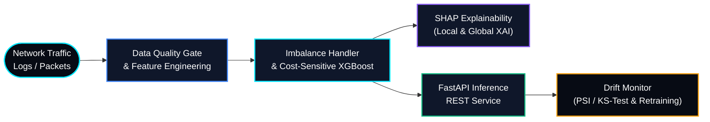

# 🛡️ SentinelML — Intrusion Detection & Explainable MLOps Pipeline

> **SentinelML** is an end-to-end supervised Machine Learning and MLOps system designed to detect network intrusions and malicious traffic patterns under severe class imbalance, complete with real-time **SHAP explainability** and **automated data-drift monitoring**.

---

## 🏗️ System Architecture

