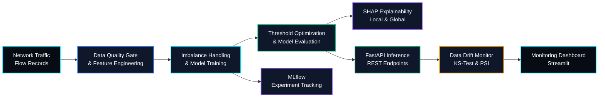

# 🛡️ SentinelML — Intrusion Detection & Explainable MLOps Pipeline


**SentinelML** is an end-to-end machine learning and MLOps project designed to detect potentially malicious network traffic and explain model predictions. It combines imbalanced classification, threshold optimization, SHAP-based explainability, validated REST inference, experiment tracking, and automated data-drift monitoring in a modular pipeline.

> **Project goal:** Build a reproducible, explainable, and deployment-ready intrusion detection pipeline with a strong focus on model quality, observability, and reliable inference.

---

## 🏗️ System Architecture



## 🎯 Project Objectives

- Detect malicious network traffic despite severe class imbalance.
- Compare machine learning models using appropriate classification metrics.
- Optimize decision thresholds using precision-recall analysis.
- Explain individual predictions using feature-level SHAP attributions.
- Expose validated predictions through a FastAPI REST interface.
- Monitor feature distribution changes and potential data drift.
- Track experiments and evaluation results with MLflow.
- Validate API behavior with automated tests and support containerized deployment.

## 🔧 Core ML & MLOps Engineering

### 1. Imbalanced Classification & Threshold Optimization

Accuracy alone can be misleading when malicious traffic represents a small fraction of the dataset. SentinelML is designed to evaluate class-weighted models, compare classification approaches, and tune decision thresholds using metrics such as Macro-F1 and PR-AUC.

### 2. Explainable AI for Security Analysis

SHAP-based explanations help identify which input features contributed to a prediction. This can support investigation of suspicious network-flow records and make model behavior easier to inspect.

### 3. Data Quality & Drift Monitoring

Statistical drift checks compare reference data against incoming observations using methods such as the Kolmogorov-Smirnov test and Population Stability Index (PSI). Monitoring results can help identify distribution changes that warrant investigation or model reevaluation.

### 4. Backend Inference & API Validation

FastAPI and Pydantic provide a structured REST interface for submitting network-flow features and returning validated predictions. Pytest supports repeatable API and input-validation checks.

### 5. Experiment Tracking & Reproducibility

MLflow can record model parameters, metrics, and experiment runs to make training comparisons easier to reproduce and audit.

## 🧰 Technology Stack

| Category | Technologies |
|---|---|
| Language | Python 3.12 |
| Data Processing | NumPy, Pandas |
| Machine Learning | Scikit-learn, XGBoost |
| Explainable AI | SHAP |
| API Serving | FastAPI, Pydantic, Uvicorn |
| Experiment Tracking | MLflow |
| Dashboard | Streamlit |
| Drift Detection | SciPy, Evidently (optional) |
| Testing | Pytest, HTTPX |
| Deployment | Docker |

## 📂 Repository Structure

```text
SentinelML/
├── api/
│   └── main.py
├── app/
│   └── dashboard.py
├── data/
│   ├── raw/
│   └── processed/
├── models/
├── src/
│   ├── data/
│   │   └── generate_data.py
│   ├── models/
│   │   └── train.py
│   └── monitoring/
│       └── drift.py
├── tests/
│   └── test_api.py
├── .gitignore
├── Dockerfile
├── requirements.txt
└── README.md
```

## 📊 Evaluation Metrics

| Metric | Purpose |
|---|---|
| PR-AUC | Evaluate positive-class detection under class imbalance |
| Macro-F1 | Measure F1 performance across classes with equal class weighting |
| Precision | Measure the proportion of predicted intrusions that are actual intrusions |
| Recall | Measure the proportion of actual intrusions successfully detected |
| KS Statistic | Quantify distribution differences between reference and current data |
| PSI | Measure the magnitude of changes in feature distributions |

## 🚀 Quickstart & Local Execution

### Prerequisites

- Python 3.12 or a compatible Python version
- Git
- VS Code or another code editor
- Docker (optional)

### 1. Clone the repository

```bash
git clone https://github.com/Aditya70-creator/SentinelML.git
cd SentinelML
```

### 2. Create a virtual environment

**Windows PowerShell:**

```powershell
python -m venv .venv
.\.venv\Scripts\Activate.ps1
```

If PowerShell blocks activation scripts, run:

```powershell
Set-ExecutionPolicy -Scope Process -ExecutionPolicy Bypass
.\.venv\Scripts\Activate.ps1
```

**Linux / macOS:**

```bash
python3 -m venv .venv
source .venv/bin/activate
```

### 3. Install dependencies

```bash
python -m pip install --upgrade pip
python -m pip install -r requirements.txt
```

### 4. Generate the dataset

```bash
python -m src.data.generate_data
```

### 5. Train and evaluate models

```bash
python -m src.models.train
```

### 6. Run automated tests

```bash
python -m pytest -v
```

### 7. Launch the FastAPI server

```bash
uvicorn api.main:app --reload --port 8000
```

Open the interactive API documentation at:

**http://127.0.0.1:8000/docs**

### 8. Launch the Streamlit dashboard

Open a second terminal, activate the same virtual environment, and run:

```bash
streamlit run app/dashboard.py
```

The dashboard will display at the local URL printed in your terminal, typically `http://localhost:8501`.

### 9. View MLflow experiments

If your training script logs experiments to MLflow, launch its interface with:

```bash
mlflow ui
```

Then open **http://127.0.0.1:5000**.

## 🐳 Docker

Build the container image:

```bash
docker build -t sentinelml .
```

Run the API container:

```bash
docker run --rm -p 8000:8000 sentinelml
```

The Docker command assumes that the Dockerfile starts the API server and that the required model artifacts are available or generated as part of the image setup.

## 🗺️ Engineering Roadmap

- [ ] Implement synthetic network-flow data generation and data-quality validation.
- [ ] Build a reproducible preprocessing and training pipeline.
- [ ] Compare Logistic Regression, Random Forest, and XGBoost baselines.
- [ ] Evaluate class imbalance and optimize classification thresholds.
- [ ] Integrate SHAP explanations into the inference API.
- [ ] Implement KS-test and PSI-based drift monitoring.
- [ ] Track model parameters and metrics with MLflow.
- [ ] Build a Streamlit monitoring dashboard.
- [ ] Add automated API, schema-validation, and model-quality tests.
- [ ] Validate Docker deployment and document reproducible experiments.

## 🔒 Responsible Use

SentinelML is intended for defensive network monitoring, research, and educational use. Model predictions are probabilistic signals and should not be treated as definitive proof of malicious activity. Detection quality depends on the training data, feature availability, and evaluation methodology.

## 👨‍💻 Author

**Aditya Mitra**

- GitHub: [Aditya70-creator](https://github.com/Aditya70-creator)
- Project: [SentinelML](https://github.com/Aditya70-creator/SentinelML)

---

<p align="center">
  <i>Building explainable machine learning systems for more observable and reliable security workflows.</i>
</p>
