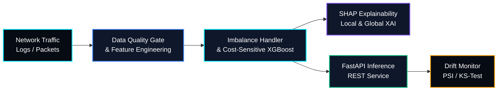

# 🛡️ SentinelML — Intrusion Detection & Explainable MLOps Pipeline


> **SentinelML** is an end-to-end supervised Machine Learning and MLOps system designed to detect network intrusions and malicious traffic patterns under severe class imbalance. It combines cost-sensitive classification, SHAP-based explainability, validated REST inference, and automated data-drift monitoring.

---

## 🏗️ System Architecture



## 🎯 Project Objectives

- Detect malicious network traffic despite severe class imbalance.
- Optimize classification thresholds using precision-recall metrics.
- Explain individual predictions with feature-level SHAP attributions.
- Serve validated predictions through a FastAPI REST interface.
- Monitor feature drift and track experiments for reproducible model evaluation.

## 🔧 Core ML & MLOps Engineering Focus

- **Imbalanced Classification & Threshold Tuning:** Moves beyond naive accuracy by optimizing **Macro-F1** and **PR-AUC** using class-weighted gradient boosting (`XGBoost` / `LightGBM`) and precision-recall threshold calibration.
- **Explainable AI (XAI) for Security Analysts:** Integrates SHAP tree explainers to identify the network features contributing to each flagged intrusion alert, such as packet rates, byte bursts, and flag anomalies, when those features are available in the dataset.
- **Data Quality & Drift Telemetry:** Tracks feature distribution shifts using **Population Stability Index (PSI)** and Kolmogorov-Smirnov tests to flag potential model degradation and initiate retraining workflows.
- **Low-Latency Backend Serving:** Exposes stateless REST endpoints via **FastAPI**, with strict `Pydantic` schema validation and **Docker** containerization.

## 🧰 Technology Stack

- **Language:** Python
- **Machine Learning:** XGBoost, LightGBM, Scikit-learn
- **Explainability:** SHAP
- **API Serving:** FastAPI, Pydantic
- **Experiment Tracking:** MLflow
- **Deployment:** Docker
- **Monitoring:** PSI, Kolmogorov-Smirnov tests

## 📂 Repository Structure

```text
SentinelML/
├── data/
│   └── README.md             # Dataset sources and data instructions
├── src/
│   ├── ingestion/            # Schema validation and data quality checks
│   ├── features/             # Leak-free preprocessing and transformations
│   ├── models/               # Model training and threshold tuning
│   ├── explainability/       # SHAP feature attribution
│   └── monitoring/           # PSI and KS-test drift detection
├── api/
│   └── main.py               # FastAPI inference endpoints
├── tests/                    # Unit and integration tests
├── Dockerfile                # Containerized runtime configuration
├── requirements.txt          # Python dependencies
└── README.md
```

*This is the proposed repository structure. Adjust filenames and directories to match the implementation. Avoid committing sensitive traffic captures or large datasets; document dataset acquisition and preprocessing instead.*

## 📊 Evaluation Metrics

| Metric | Purpose |
|---|---|
| PR-AUC | Evaluate positive-class detection under class imbalance |
| Macro-F1 | Balance F1 performance across classes |
| Precision | Measure how many predicted intrusions are actual intrusions |
| Recall | Measure how many actual intrusions are detected |
| False Positive Rate | Track benign traffic incorrectly flagged as malicious |
| PSI | Measure shifts in feature distributions |
| KS Statistic | Compare feature distributions across reference and current data |

## 🗺️ Engineering Roadmap

- [x] System architecture design and evaluation metric formulation (`PR-AUC`, `Macro-F1`)
- [x] Leak-free preprocessing and class-imbalance baseline pipeline
- [ ] SHAP local/global explanation endpoint integration
- [ ] Automated drift detection telemetry and MLflow model tracking
- [ ] FastAPI inference endpoints with Pydantic validation
- [ ] Dockerized inference service
- [ ] Automated model-quality monitoring and retraining workflow
- [ ] Unit tests, integration tests, and reproducible evaluation

## 🔬 Dataset & Evaluation Strategy

Candidate datasets include **CICIDS** and **NSL-KDD**. Select a dataset based on the intended intrusion-detection task, document its provenance, and keep training and evaluation splits separate.

- Fit preprocessing transformations on training data only.
- Prevent data leakage during feature engineering and validation.
- Report per-class metrics alongside aggregate scores.
- Tune classification thresholds on validation data, not the final test set.
- Record dataset versions, experiment parameters, and model metrics.

## ⚠️ Project Status

SentinelML is under active development. The roadmap distinguishes planned integrations from implemented functionality. Mark a milestone complete only after the corresponding feature has been implemented and tested.

---

*SentinelML — Explainable intrusion detection with reproducible ML engineering and practical MLOps.*
