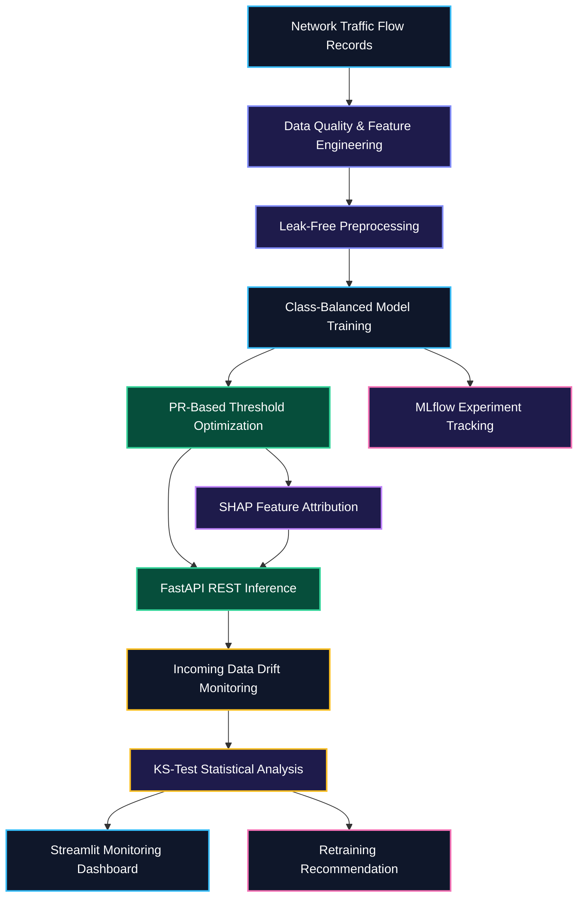

 <div align="center">
  

  <br/><br/>

  <a href="https://sentinel-8xkyi5wo6ggso83y8jbvxz.streamlit.app/" target="_blank">
    
  </a>

  <br/><br/>

  
  
  
  
  
  
</div>

---

## 📌 Overview

**SentinelML** is an end-to-end machine learning and MLOps platform designed to detect potentially malicious network traffic under severe class imbalance.

Instead of relying solely on accuracy, SentinelML combines leak-free preprocessing, class-balanced model training, precision-recall threshold optimization, SHAP-based explainability, validated FastAPI inference, MLflow experiment tracking, and statistical data-drift monitoring.

The project demonstrates how machine learning can be integrated into a reproducible, testable, and observable cybersecurity workflow.

### 🎯 Project Objectives

- Detect potentially malicious network traffic using machine learning.
- Compare classification models using appropriate evaluation metrics.
- Prevent data leakage through training-only preprocessing.
- Optimize decision thresholds using precision-recall analysis.
- Explain individual predictions using SHAP feature attributions.
- Expose predictions through validated REST API endpoints.
- Monitor changes in incoming network telemetry.
- Track experiments, parameters, metrics, and artifacts using MLflow.
- Validate API behavior through automated tests and CI.
- Support containerized execution using Docker.

---

## 🏗️ End-to-End Pipeline & Architecture

<div align="center">
  
</div>

### System Architecture



The architecture separates data preparation, model development, inference, explainability, and monitoring into distinct stages to improve maintainability, reproducibility, and testing.

---

## 📊 Model Benchmark & Experimental Results

The following values are the reported benchmark results supplied for this project. They should be reproduced from the training pipeline and saved evaluation artifacts before being treated as independently verified results.

| Candidate Model | PR-AUC | F1-Score | Recall | Optimal Threshold |
|---|---:|---:|---:|---:|
| 🏆 Random Forest Classifier | 0.8891 | 0.9200 | 0.8625 | 0.5533 |
| XGBoost Classifier | 0.8852 | 0.9200 | 0.8625 | 0.5410 |
| Logistic Regression | 0.8808 | 0.9128 | 0.8500 | 0.5120 |

**Reported best candidate:** Random Forest Classifier.

Random Forest has the highest reported PR-AUC in this comparison. Precision, recall, and F1-score are also important because an intrusion detection system must balance missed attacks against false alarms.

### Evaluation Considerations

- Fit imputers, scalers, and other preprocessing transformations using training data only.
- Use held-out evaluation data for model comparison.
- Select the decision threshold using validation data rather than the final test set.
- Document the positive class, data-splitting strategy, and averaging method used for each metric.
- Re-run the benchmark to verify that displayed results match the saved artifacts.

> **Note:** The supplied F1-score, recall, and threshold values are preserved here as reported project results. Their exact calculation methods and reproducibility should be confirmed from the training code. The reported values should not be interpreted as independently validated measurements until verified.

---

## 🔧 Core ML & MLOps Capabilities

### 1. Imbalanced Classification & Threshold Calibration

Intrusion detection datasets may contain substantially fewer malicious samples than normal traffic. Accuracy alone can therefore conceal poor detection performance.

SentinelML compares Logistic Regression, Random Forest, and XGBoost models and supports class-imbalance handling and decision-threshold tuning.

The objective is to identify a practical balance between precision and recall for the target classification task.

### 2. Leak-Free Preprocessing

The preprocessing pipeline is designed to handle missing values and feature scaling consistently.

- **SimpleImputer:** Handles missing values.
- **StandardScaler:** Scales numerical features where appropriate.
- **Training-only fitting:** Helps prevent information leakage into evaluation data.
- **Reusable pipelines:** Help maintain consistency between training and inference.

### 3. Explainable AI with SHAP

SHAP feature attributions help inspect the factors contributing to a model's predictions.

Reported telemetry features include:

- `dst_port_entropy`
- `failed_login_attempts`
- `flow_bytes_per_sec`
- `syn_flag_count`

These explanations can help developers investigate model behavior and understand which input features influenced a particular prediction.

SHAP explanations describe model behavior; they do not independently establish that a network flow is malicious.

### 4. Statistical Data Drift Monitoring

SentinelML uses two-sample Kolmogorov-Smirnov testing to compare reference and incoming numerical feature distributions.

- Evaluates nine telemetry features in the reported configuration.
- Identifies potential distribution changes in incoming network data.
- Provides drift signals for further investigation.
- Supports retraining recommendations based on monitoring results.

A drift alert does not prove that model accuracy has decreased. Retraining should not automatically be triggered without additional validation and safeguards.

A PSI-based monitoring extension can be added if implemented and tested in the codebase.

### 5. FastAPI Inference & Validation

FastAPI provides REST endpoints for model inference, with Pydantic schemas for request validation.

The documented API surface includes:

| Endpoint | Intended Purpose |
|---|---|
| `GET /health` | Check service health |
| `GET /metrics` | Retrieve available metrics |
| `POST /predict` | Generate a prediction |
| `GET /drift-status` | Inspect current drift status |

Interactive API documentation is available through Swagger UI when the server is running.

> Verify endpoint names, HTTP methods, response formats, and implementation status against `api/main.py`.

### 6. MLflow Experiment Tracking

MLflow supports experiment tracking during model development.

Depending on the implementation, tracked information can include:

- Model parameters and training configuration.
- PR-AUC, F1-score, recall, and other evaluation metrics.
- Experiment run identifiers.
- Model artifacts and serialized pipelines.

### 7. Streamlit Monitoring Dashboard

The Streamlit dashboard provides an interactive interface for inspecting model predictions, feature explanations, and data drift.

Its exact capabilities depend on the implemented dashboard pages and the availability of the required model and monitoring artifacts.

**[🚀 Launch the SentinelML Live Dashboard](https://sentinel-8xkyi5wo6ggso83y8jbvxz.streamlit.app/)**

### 8. Automated Testing & CI/CD

- **Pytest:** Validates API behavior and expected inference responses.
- **GitHub Actions:** Automates test execution when configured for pushes and pull requests.
- **Docker:** Provides a consistent runtime environment for the inference service.

---

## 🧰 Technology Stack

| Component | Technology | Purpose |
|---|---|---|
| Language | Python 3.11 | Core application and ML code |
| Data Processing | Pandas, NumPy | Feature engineering and data handling |
| Machine Learning | Scikit-learn | Preprocessing, baselines, and evaluation |
| Gradient Boosting | XGBoost | Classification model |
| Explainability | SHAP | Feature attribution |
| API | FastAPI | REST inference endpoints |
| Validation | Pydantic | Request and response schemas |
| Experiment Tracking | MLflow | Experiment metrics and artifacts |
| Drift Detection | SciPy | Statistical tests such as `ks_2samp` |
| Dashboard | Streamlit | Interactive monitoring interface |
| Testing | Pytest | Automated API and pipeline tests |
| Containerization | Docker | Reproducible runtime |
| CI/CD | GitHub Actions | Automated validation workflow |

---

## 📂 Repository Structure

The following tree represents the intended project layout. Adjust it to match the files actually present in the repository.

```text
SentinelML/
├── .github/
│   └── workflows/
│       └── ci.yml
├── api/
│   └── main.py
├── app/
│   └── dashboard.py
├── assets/
│   ├── sentinel-banner.svg
│   └── sentinel-pipeline.svg
├── data/
│   └── raw/
├── models/
├── src/
│   ├── data/
│   │   └── generate_data.py
│   ├── models/
│   │   └── train.py
│   └── monitoring/
│       └── drift.py
├── tests/
│   └── test_api.py
├── Dockerfile
├── requirements.txt
├── .gitignore
└── README.md
```

### Key Directories

- `api/` — FastAPI inference and monitoring endpoints.
- `app/` — Streamlit dashboard.
- `assets/` — Repository banner and pipeline illustration.
- `data/` — Raw or generated network telemetry.
- `models/` — Saved pipelines, model artifacts, and metadata.
- `src/data/` — Telemetry generation and data preparation.
- `src/models/` — Model training and MLflow tracking.
- `src/monitoring/` — Statistical drift monitoring.
- `tests/` — Automated API and inference tests.

---

## 🚀 Quickstart & Local Execution

### 🌐 Live Cloud Demo

Explore the hosted dashboard without setting up the project locally.

**[Open SentinelML on Streamlit Cloud](https://sentinel-8xkyi5wo6ggso83y8jbvxz.streamlit.app/)**

### Prerequisites

- Git
- Python 3.11
- pip
- Docker (optional)

### 1. Clone the Repository

```powershell
git clone https://github.com/Aditya70-creator/SentinelML.git
cd SentinelML
```

### 2. Create and Activate a Virtual Environment

**Windows PowerShell**

```powershell
python -m venv .venv
.\.venv\Scripts\Activate.ps1
```

If PowerShell blocks script execution, you can use the environment's Python executable directly:

```powershell
.\.venv\Scripts\python.exe -m pip install --upgrade pip
.\.venv\Scripts\python.exe -m pip install -r requirements.txt
```

**Linux / macOS**

```bash
python3 -m venv .venv
source .venv/bin/activate
python -m pip install --upgrade pip
pip install -r requirements.txt
```

### 3. Install Dependencies

If the virtual environment is activated:

```powershell
python -m pip install --upgrade pip
pip install -r requirements.txt
```

### 4. Generate Network Telemetry

```powershell
python -m src.data.generate_data
```

This command should generate the dataset files expected by the training pipeline.

### 5. Train and Evaluate Models

```powershell
python -m src.models.train
```

The training script should preprocess the data, train the configured candidate models, evaluate performance, and log experiments to MLflow where configured.

### 6. Run the Test Suite

```powershell
$env:PYTHONPATH = "."
pytest -v
```

Resolve failing tests before considering the current code version validated.

### 7. Start the FastAPI Server

```powershell
uvicorn api.main:app --reload --host 127.0.0.1 --port 8000
```

Open the interactive API documentation:

- **Swagger UI:** http://127.0.0.1:8000/docs
- **OpenAPI schema:** http://127.0.0.1:8000/openapi.json

### 8. Launch the Streamlit Dashboard

Open a second terminal, activate the virtual environment, and run:

```powershell
streamlit run app/dashboard.py
```

The default local dashboard URL is:

http://localhost:8501

The dashboard and API may need to be configured to use the same API base URL.

---

## 📡 API Usage

### Example `/predict` Request

The following JSON payload illustrates the reported nine-feature telemetry schema. The field names and types must match the Pydantic model implemented in `api/main.py`.

```json
{
  "flow_duration_ms": 1450.5,
  "total_fwd_packets": 52,
  "total_bwd_packets": 3,
  "packet_length_mean": 820.0,
  "syn_flag_count": 7,
  "rst_flag_count": 3,
  "flow_bytes_per_sec": 74000.0,
  "failed_login_attempts": 4,
  "dst_port_entropy": 0.82
}
```

### Test the Endpoint

With the API server running, save the example payload as `sample_request.json` in the project root.

Execute the following PowerShell command:

```powershell
Invoke-RestMethod `
  -Uri "http://127.0.0.1:8000/predict" `
  -Method Post `
  -ContentType "application/json" `
  -InFile "sample_request.json"
```

This request illustrates the intended workflow. It will work only if the running API accepts the exact payload schema and has loaded the required model artifacts.

### API Endpoint Reference

| Method | Endpoint | Purpose |
|---|---|---|
| GET | `/health` | Service health check |
| GET | `/metrics` | Available service or model metrics |
| POST | `/predict` | Model inference |
| GET | `/drift-status` | Drift monitoring status |

Verify the actual HTTP methods, endpoint names, and response formats against the FastAPI implementation.

---

## 🐳 Docker Deployment

### Build the Docker Image

Run this command from the project root:

```powershell
docker build -t sentinelml .
```

### Start the Inference Service

```powershell
docker run --rm -p 8000:8000 sentinelml
```

Open the API documentation:

http://localhost:8000/docs

### Docker Configuration Notes

The Dockerfile should:

- Install the required project dependencies.
- Copy the necessary application modules.
- Include or reliably load the required model artifacts.
- Expose the configured API port.
- Start the application using the correct ASGI module and host binding.

For a containerized API, the application typically needs to bind to `0.0.0.0` inside the container.

The local development command uses `127.0.0.1` for local access. The Streamlit dashboard will not automatically start in the same container unless the Docker configuration explicitly launches it.

---

## 🔬 Engineering Practices

SentinelML is designed around practical machine learning engineering principles:

- **Leakage prevention:** Fit preprocessing transformations on training data only.
- **Reproducibility:** Document experiment configuration, random seeds, and evaluation procedures.
- **Model consistency:** Apply the same preprocessing transformations during training and inference.
- **Input validation:** Reject malformed requests and invalid inputs.
- **Testing:** Cover valid requests, invalid inputs, and important edge cases.
- **Observability:** Track experiment metrics and monitor incoming data changes.
- **Artifact management:** Organize model versions, serialized pipelines, and metadata.
- **Secure development:** Avoid committing credentials, secrets, and unnecessary large datasets.
- **Automated checks:** Run tests through GitHub Actions where configured.

---

## 🗺️ Engineering Roadmap

The following milestones describe the intended project scope. A completed checkbox should represent functionality that has been implemented and verified in the current codebase.

- [x] Synthetic network-flow telemetry and drifted-batch generation
- [x] Leak-free preprocessing with SimpleImputer and StandardScaler
- [x] Logistic Regression, Random Forest, and XGBoost comparison
- [x] Precision-recall threshold calibration
- [x] Benchmark reporting and saved model metadata
- [x] SHAP feature attribution in the inference workflow
- [x] KS-test-based feature drift monitoring
- [x] Drift alert and retraining recommendation logic
- [x] MLflow experiment and artifact tracking
- [x] Interactive Streamlit explainability and monitoring dashboard
- [x] Automated API and schema validation tests
- [x] Dockerized inference service
- [x] GitHub Actions workflow
- [x] Documented API examples and local setup instructions

> **Verification note:** These checkboxes preserve the supplied project status. Confirm each milestone against the implementation, test results, and CI run before presenting it as verified.

---

## 🔐 Security & Responsible Use

SentinelML is intended for educational, research, and defensive cybersecurity applications.

- Use authorized datasets and network telemetry.
- Protect sensitive network-flow records and operational information.
- Validate API inputs and avoid exposing internal exceptions or sensitive data.
- Treat model predictions as decision-support signals rather than definitive proof of malicious activity.
- Evaluate false positives and false negatives before operational use.
- Do not deploy the model as a production security control without appropriate testing, monitoring, and human oversight.

---

## 🤝 Contributing

Contributions, bug reports, and improvement suggestions are welcome.

1. Fork the repository.
2. Create a feature branch.
3. Implement your changes.
4. Run the relevant tests.
5. Submit a pull request describing your changes.

For changes to the model, API, or monitoring logic, include automated tests wherever practical.

---

## 📄 License

This project is intended to use the MIT License.

See [`LICENSE`](./LICENSE) for the license terms, provided the repository contains a valid MIT License file.

---

## 👨‍💻 Author

**Aditya Mitra**

- GitHub: [@Aditya70-creator](https://github.com/Aditya70-creator)
- Repository: [SentinelML](https://github.com/Aditya70-creator/SentinelML)

---

<div align="center">
  <sub>Built with Python, Machine Learning, and MLOps engineering principles.</sub>
  <br/>
  <sub>SentinelML — Intelligent Network Threat Detection & Monitoring</sub>
</div>
