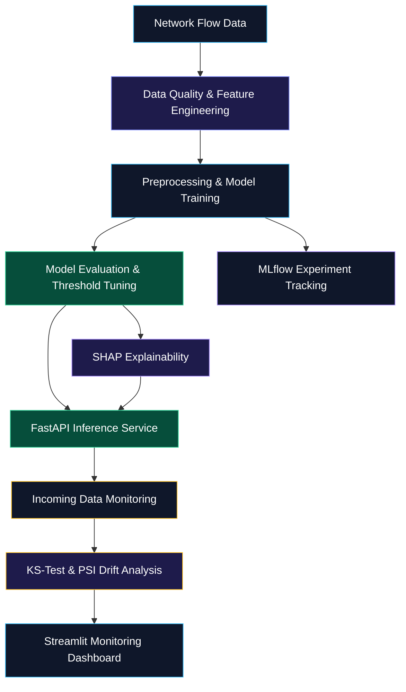

# 🛡️ SentinelML — Explainable Network Intrusion Detection & MLOps Pipeline

<p align="center">
  
  
  
  
</p>

<p align="center">
  <b>An end-to-end machine learning pipeline for network intrusion detection, explainable predictions, experiment tracking, and data drift monitoring.</b>
</p>

<p align="center">
  
  
  
  
  
  
</p>

---

## 📌 Overview

**SentinelML** is a cybersecurity-focused machine learning and MLOps project designed to classify network traffic, explain model predictions, and monitor potential changes in incoming data.

The project combines an ML training pipeline with a REST API, explainability tools, experiment tracking, automated tests, and an interactive monitoring dashboard.

### 🎯 Project Objectives

- Detect potentially malicious network traffic using machine learning.
- Evaluate classification performance under class imbalance.
- Optimize classification thresholds using precision-recall analysis.
- Explain predictions using SHAP feature attributions.
- Serve validated inference requests through FastAPI.
- Monitor feature distribution changes using statistical drift detection.
- Track experiments and evaluation metrics using MLflow.
- Validate API behavior with automated tests.
- Support reproducible execution and containerized deployment.

## 🏗️ System Architecture



## ⚙️ Core ML & MLOps Engineering

### 1. Imbalanced Classification & Threshold Optimization

Accuracy alone can be misleading when malicious traffic represents a small fraction of the dataset.

SentinelML is designed to compare classification models, evaluate class imbalance handling strategies, and tune decision thresholds using metrics such as Macro-F1 and PR-AUC.

### 2. Explainable AI for Security Analysis

SHAP-based explanations help identify the features contributing to individual predictions and provide a way to inspect model behavior.

This supports model transparency and helps developers investigate potentially suspicious predictions.

### 3. Data Quality & Drift Monitoring

Statistical monitoring compares reference data with incoming observations to identify potential changes in feature distributions.

- **Kolmogorov-Smirnov (KS) test:** Measures differences between numerical feature distributions.
- **Population Stability Index (PSI):** Provides an additional measure of distribution change when implemented.

Drift alerts indicate that a dataset or model may need further investigation; they do not automatically prove a decline in model accuracy.

### 4. Backend Inference & API Validation

FastAPI and Pydantic provide a structured interface for submitting network-flow features and receiving validated prediction responses.

Pytest is used to test API behavior, input validation, and expected responses.

### 5. Experiment Tracking & Reproducibility

MLflow records experiment parameters, metrics, and model artifacts to support repeatable training runs and comparisons between model versions.

## 🧰 Technology Stack

| Component | Technology | Purpose |
|---|---|---|
| Programming Language | Python | ML pipeline and backend |
| Data Processing | Pandas, NumPy | Data preparation and analysis |
| Machine Learning | Scikit-learn, XGBoost | Model training and evaluation |
| Explainable AI | SHAP | Feature-level explanations |
| API Backend | FastAPI, Pydantic | Validated REST inference |
| Experiment Tracking | MLflow | Run and metric tracking |
| Drift Monitoring | SciPy, NumPy, Pandas | Statistical distribution analysis |
| Dashboard | Streamlit | Interactive monitoring interface |
| Testing | Pytest | Automated testing |
| Containerization | Docker | Reproducible deployment |
| CI/CD | GitHub Actions | Automated workflow execution |

*The listed libraries and integrations should match the dependencies and implementations present in the repository.*

## 📂 Repository Structure

```text
SentinelML/
├── api/
│   └── main.py              # FastAPI endpoints and inference
├── app/
│   └── dashboard.py         # Streamlit dashboard
├── data/
│   └── raw/                 # Generated or source datasets
├── models/
│   └── .gitkeep             # Placeholder for model artifacts
├── src/
│   ├── data/
│   │   └── generate_data.py # Network-flow data generation
│   ├── models/
│   │   └── train.py         # Training and MLflow tracking
│   └── monitoring/
│       └── drift.py         # Statistical drift detection
├── tests/
│   └── test_api.py          # API and schema tests
├── .github/
│   └── workflows/
│       └── ci.yml           # CI workflow, if configured
├── Dockerfile
├── requirements.txt
├── .gitignore
└── README.md
```

*This is the intended project layout. Keep only files and directories that actually exist in your repository.*

## 📊 Evaluation Metrics

| Metric | Purpose |
|---|---|
| PR-AUC | Evaluates precision-recall performance, especially under class imbalance |
| Macro-F1 | Gives equal weight to each class's F1 score |
| Precision | Measures how many predicted intrusions are actually positive |
| Recall | Measures how many actual intrusions are detected |
| KS Statistic | Quantifies differences between two numerical distributions |
| PSI | Quantifies changes in feature distributions when implemented |

For an intrusion detection system, precision and recall should be evaluated together: low precision can cause excessive false alarms, while low recall can allow malicious traffic to go undetected.

## 🚀 Quickstart & Local Execution

### Prerequisites

Install the following before running the project:

- Python 3.10 or a compatible version supported by the dependencies
- Git
- Docker, if you want to run the containerized service

### 1. Clone the Repository

```bash
git clone https://github.com/Aditya70-creator/SentinelML.git
cd SentinelML
```

### 2. Create a Virtual Environment

**Windows PowerShell**

```powershell
python -m venv .venv
.\.venv\Scripts\Activate.ps1
```

If PowerShell blocks environment activation, you can invoke the environment's Python executable directly instead:

```powershell
.\.venv\Scripts\python.exe -m pip install --upgrade pip
```

**Linux / macOS**

```bash
python3 -m venv .venv
source .venv/bin/activate
```

### 3. Install Dependencies

```bash
python -m pip install --upgrade pip
pip install -r requirements.txt
```

### 4. Generate Data

```bash
python -m src.data.generate_data
```

Ensure the data generator creates the dataset files expected by the training pipeline.

### 5. Train the Models

```bash
python -m src.models.train
```

The training pipeline should preprocess the data, train the configured models, evaluate their performance, and record experiment results in MLflow where configured.

### 6. Run Automated Tests

```bash
pytest -v
```

Resolve any failing tests before treating the current implementation as validated.

### 7. Start the FastAPI Service

```bash
uvicorn api.main:app --reload --host 127.0.0.1 --port 8000
```

Open the interactive API documentation in your browser:

http://127.0.0.1:8000/docs

### 8. Start the Streamlit Dashboard

Open a separate terminal, activate the same virtual environment, and run:

```bash
streamlit run app/dashboard.py
```

Streamlit will print the local URL where the dashboard is available.

## 🐳 Docker Deployment

Build the Docker image from the project root:

```bash
docker build -t sentinelml .
```

Run the inference service:

```bash
docker run --rm -p 8000:8000 sentinelml
```

Open the API documentation:

http://localhost:8000/docs

**Note:** The Dockerfile must install the required dependencies, include the model artifacts or provide a reliable model-loading strategy, and start the API using the correct module path. If the dashboard is not included in the container, run it separately.

## 🔬 Reproducibility & Engineering Practices

SentinelML aims to follow practical ML engineering principles:

- Separate data generation, model training, inference, and monitoring modules.
- Keep preprocessing consistent between training and inference.
- Avoid fitting preprocessing steps on evaluation or test data.
- Use a fixed random seed where appropriate.
- Record relevant experiment parameters and evaluation metrics.
- Validate incoming API payloads.
- Test normal requests, invalid inputs, and edge cases.
- Keep secrets, local environments, and large generated artifacts out of version control.
- Use CI to run automated tests on relevant code changes.

## 🗺️ Engineering Roadmap

The following checklist represents the planned implementation milestones. Mark a task complete only after verifying it in the repository.

- [ ] Network-flow data generation and validation
- [ ] Reproducible preprocessing and training pipeline
- [ ] Baseline model comparison: Logistic Regression, Random Forest, and XGBoost
- [ ] Class imbalance handling and threshold optimization
- [ ] SHAP explanations integrated into inference
- [ ] KS-test-based feature drift monitoring
- [ ] PSI-based drift monitoring, if implemented
- [ ] MLflow experiment tracking
- [ ] Streamlit monitoring dashboard
- [ ] Automated API and schema validation tests
- [ ] Docker containerization
- [ ] GitHub Actions CI workflow
- [ ] Documented API request and response examples
- [ ] Model performance report on a clearly identified test dataset

## 🔐 Security & Responsible Use

SentinelML is intended for educational, research, and defensive cybersecurity applications.

- Use authorized datasets and network telemetry.
- Do not send sensitive production traffic data to external services without appropriate authorization.
- Validate input data and avoid exposing internal errors or sensitive information through API responses.
- Do not interpret a model prediction as definitive proof of malicious activity.
- Evaluate false positives, false negatives, and performance on representative data before considering operational use.

## 🤝 Contributing

Contributions, bug reports, and suggestions are welcome.

1. Fork the repository.
2. Create a feature branch.
3. Implement and test your changes.
4. Submit a pull request with a clear description of the change.

Please include relevant tests when modifying model behavior, API contracts, or monitoring logic.

## 📄 License

This project is intended to use the MIT License.

## 👨‍💻 Author

**Aditya Mitra**

- GitHub: [@Aditya70-creator](https://github.com/Aditya70-creator)
- Project: [SentinelML](https://github.com/Aditya70-creator/SentinelML)

---

<p align="center">
  <b>Building reliable, explainable, and reproducible machine learning systems.</b>
</p>
